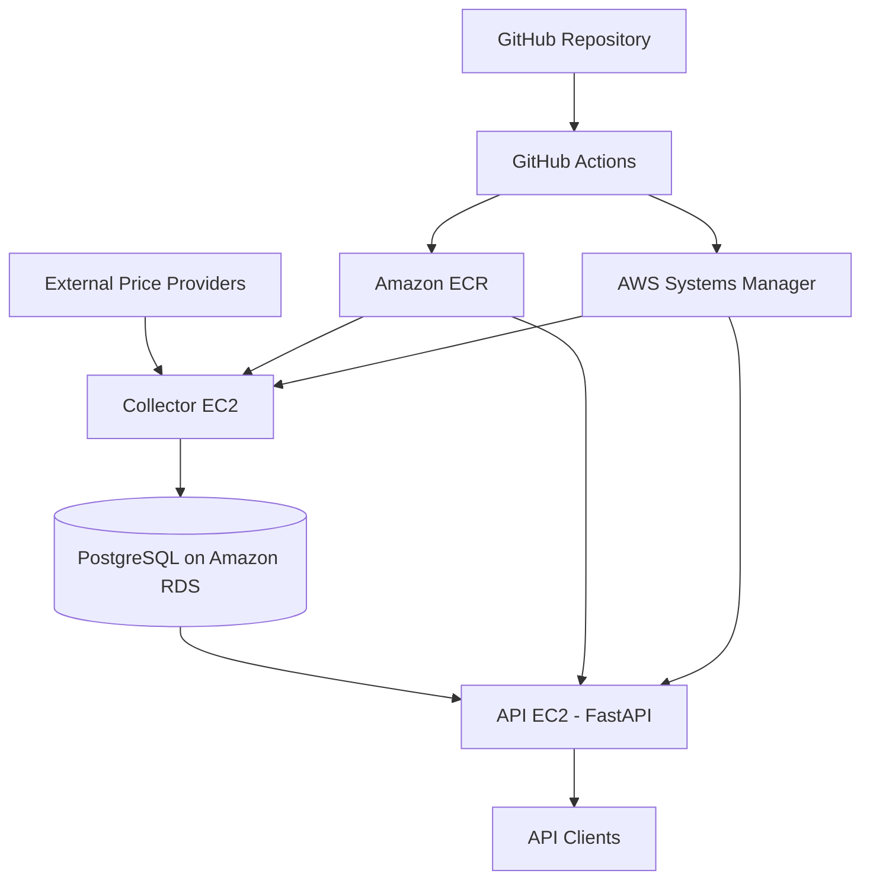

# MarketWatch

**Author:** Zach Jaros  
**License:** MIT

MarketWatch is a cloud-hosted market-data application that collects Bitcoin and gold prices, persists historical observations in PostgreSQL, and exposes the data through a REST API.

The project serves as a practical exploration of cloud infrastructure, application development, deployment automation, and operational resilience using AWS and Terraform.

## Table of Contents

- [Key Features](#key-features)
- [Technology Stack](#technology-stack)
- [Architecture](#architecture)
- [Application Component: API](#application-component-api)
- [Application Component: Collector](#application-component-collector)
- [Application Component: Database](#application-component-database)
- [Application Component: Frontend](#application-component-frontend)
- [Cost Management](#cost-management)
- [Design Decisions](#design-decisions)
- [IAM Permissions](#iam-permissions)
- [Useful Commands](#useful-commands)

## Key Features

- **Infrastructure as Code:** Provision and manage AWS infrastructure with Terraform.
- **Containerized workloads:** Package the API and collector into Docker images for consistent deployment.
- **Automated CI/CD:** Use GitHub Actions to build and publish images to Amazon ECR, then trigger deployments through AWS Systems Manager.
- **Cloud security:** Use GitHub OIDC federation, IAM roles, security groups, private subnets, and AWS Secrets Manager to control access.
- **Persistent storage:** Store historical observations in Amazon RDS for PostgreSQL, with Alembic managing schema migrations.
- **Infrastructure recovery:** Use PowerShell scripts and RDS snapshots to support infrastructure teardown and restoration.

## Technology Stack

| Category | Technologies |
|---|---|
| Application | Python, FastAPI, SQLAlchemy, Alembic |
| Database | PostgreSQL, Amazon RDS |
| Containers | Docker, Docker Compose, Amazon ECR |
| Infrastructure | Terraform, Amazon EC2, VPC, subnets, security groups |
| Security | IAM, OIDC, AWS Secrets Manager |
| Deployment | GitHub Actions, AWS Systems Manager |
| Development | Git, `uv`, HTML/JavaScript (where applicable) |

The project emphasizes reproducible infrastructure, controlled access, automated deployment, and the separation of data collection, API serving, and persistent storage.

# Architecture

MarketWatch is a containerized market-data application deployed on AWS using Terraform-managed infrastructure. The system separates data collection, API serving, and persistent storage into independent components.

The application runs on two EC2 instances: one hosts the FastAPI application, while the other runs the data collector. Both connect to a private Amazon RDS for PostgreSQL instance, allowing the collector to continue gathering data independently of API traffic.

## Data Flow

1. The collector retrieves market-price data from external providers.
2. Retrieved observations are persisted to PostgreSQL using SQLAlchemy.
3. The FastAPI application queries PostgreSQL and exposes historical observations and trend data through HTTP endpoints.
4. Clients access the API through its public endpoint.

## Deployment Flow

1. Changes are pushed to the GitHub repository.
2. GitHub Actions builds the application’s Docker image.
3. The image is pushed to Amazon Elastic Container Registry (ECR).
4. GitHub Actions authenticates to AWS using OpenID Connect (OIDC) and initiates deployment through AWS Systems Manager (SSM).
5. The API and collector instances independently pull and run the updated image.

## Infrastructure

Terraform manages the AWS resources, including the VPC, subnets, security groups, EC2 instances, IAM roles, ECR repository, and RDS database.

The database resides in private subnets and is not directly accessible from the public internet. EC2 security groups control application and database connectivity, while AWS Secrets Manager stores the database's managed master credentials.

# Application Component: API

The API is built with FastAPI and provides HTTP access to the market observations stored in PostgreSQL.

SQLAlchemy handles database interactions, while Alembic manages schema migrations. This separates application-level data access from database schema evolution and allows migrations to be applied as part of deployment.

## Endpoints

| Endpoint | Description |
|---|---|
| `GET /prices` | Retrieves stored price observations. |
| `GET /prices/{asset}/history` | Retrieves historical observations for a specified asset. |
| `GET /prices/btc/trend` | Retrieves Bitcoin trend data. |

The API runs in a Docker container on a dedicated EC2 instance. Its deployment process retrieves the database connection information from AWS, applies pending Alembic migrations, and starts the updated container.

Separating the API from the collector allows either component to be deployed or restarted without requiring both workloads to share the same compute instance.

# Application Component: Collector

The collector is responsible for retrieving external market-price data and persisting observations to PostgreSQL.

It runs independently of the API in its own Docker container on a dedicated EC2 instance. This separation isolates scheduled data collection from API request handling and allows the workloads to be managed independently.

## Data Sources

The collector integrates with external providers for cryptocurrency and gold-price data, including:

- **CoinGecko** — Bitcoin price data in USD.
- **GoldPriceAPI** — gold spot-price data, including the XAU-USD-SPOT instrument.

Collected observations are written to PostgreSQL through SQLAlchemy. The database provides persistent historical records that the API can query for price history and trend calculations.

The collector and API share the same application image but use separate Docker Compose configurations and EC2 instances. This avoids running duplicate collection processes when deploying or restarting the API.

# Application Component: Database

MarketWatch uses Amazon RDS for PostgreSQL as its persistent data store. The database is deployed in private subnets and accepts connections from the application components through security-group rules.

## Schema and Persistence

The `price_observations` table stores collected market data, including:

- `id` — observation identifier.
- `asset` — asset or instrument identifier.
- `price` — recorded price.
- `timestamp` — observation timestamp.
- `source` — data provider associated with the observation.

SQLAlchemy provides the application's database access layer, and Alembic tracks and applies schema migrations. This allows database changes to be version-controlled alongside application code.

## Credentials and Security

The RDS instance uses AWS-managed master credentials stored in AWS Secrets Manager. The application retrieves the necessary connection information at deployment time using its EC2 IAM role.

The database is not publicly accessible. Connectivity is restricted to authorized application security groups, keeping database access separate from public API access.

## Backup and Recovery

The project includes PowerShell scripts for infrastructure teardown and recovery:

- `down.ps1` creates an RDS snapshot before destroying Terraform-managed infrastructure.
- `up.ps1` uses the saved recovery configuration to plan and recreate the infrastructure from the selected snapshot.

This approach allows the compute and networking resources to be recreated while preserving historical observations in the database snapshot.

# Application Component: Frontend

The MarketWatch frontend is a lightweight HTML/JavaScript interface that displays current Bitcoin and gold prices alongside historical market trends. It communicates with the FastAPI backend to retrieve price data and calculate summary statistics for user-selected time periods.

## Current Features

- **Current Prices:** Retrieves and displays the latest available Bitcoin (BTC) and gold prices in USD.
- **Historical High and Low:** Identifies the highest and lowest prices within the selected period, including the associated observation timestamp or an indication that the current price establishes a new high or low.
- **Percentage Change:** Displays the percentage change between the earliest and latest observations returned for the selected period, with color-coded text to distinguish positive and negative changes.
- **Configurable Time Periods:** Provides 1-day, 7-day, 30-day, and 1-year views for both assets. Selecting a period triggers a new API request and updates the corresponding statistics.

## Implementation

The interface is implemented using standard HTML and JavaScript, without a frontend framework. The JavaScript uses the Fetch API to retrieve current prices from `GET /prices` and historical trend observations from `GET /prices/{asset}/trend?days={days}`.

The frontend processes the returned historical observations to determine the high and low prices and calculate the percentage change. The FastAPI backend provides the underlying data from the PostgreSQL database, keeping data collection and persistence separate from the presentation layer.

The frontend is intentionally minimal, providing a functional overview of market conditions while leaving room for future enhancements such as interactive charts, improved formatting, and additional assets.

# Cost Management

MarketWatch uses AWS resources that can incur charges while provisioned, even when the application is idle.

During one development period, the deployed infrastructure incurred **$3.78 over approximately one week of intermittent use**. This is a historical observation from my own environment, not a guaranteed operating cost or pricing estimate.

The main resources to monitor are:

- **Amazon RDS:** Database instance runtime, storage, backups, and retained snapshots.
- **Amazon EC2:** Compute instance runtime and associated storage.
- **Networking:** Public IPv4 addresses, data transfer, and any paid networking services.
- **AWS Secrets Manager:** Secret storage and API usage.

## Cost-control recommendations

- Configure an AWS Budget and billing alerts before deploying.
- Inspect the resources that remain after running the teardown script.
- Check for retained RDS snapshots and other persistent resources.
- Review the AWS Cost Explorer breakdown periodically.
- Verify current Free Tier eligibility and pricing before provisioning resources.

Always review the Terraform plan before applying infrastructure changes, and verify the resulting AWS resources after teardown.

# Design Decisions

## Terraform for Infrastructure as Code

**Decision:** Use Terraform to provision and manage AWS infrastructure.

**Rationale:** Infrastructure is defined declaratively and version-controlled, making changes repeatable, reviewable, and easier to reproduce. Terraform also makes it possible to tear down and recreate the environment without manually rebuilding each resource.

**Trade-offs:** Terraform introduces state management and provider/module configuration overhead. Infrastructure changes also require care because an incorrect plan can replace or destroy resources. Persistent data requires separate recovery planning rather than relying on infrastructure recreation alone.

## Amazon RDS for PostgreSQL

**Decision:** Host PostgreSQL on Amazon RDS rather than on an EC2 instance.

**Rationale:** RDS separates database management from application compute and provides managed database operations, backups, and recovery capabilities. Keeping the database in a private subnet also prevents direct public access.

**Trade-offs:** RDS adds ongoing cost and another managed resource to configure. It also introduces dependencies on AWS networking, credentials, and database availability. For a small demonstration project, hosting PostgreSQL on the same EC2 instance would be cheaper, but would couple database availability and lifecycle to the application host and increase operational responsibility.

## Docker and Amazon ECR

**Decision:** Package application components as Docker images and store them in Amazon ECR.

**Rationale:** Container images provide a consistent runtime environment and separate application packaging from deployment. ECR gives EC2 instances a centralized location from which to pull published images.

**Trade-offs:** Docker introduces image-building, registry authentication, storage, and cleanup requirements. Containers also add some operational complexity compared with running a Python application directly on a host. In return, deployments become more consistent and easier to automate.

## GitHub Actions with OIDC

**Decision:** Use GitHub Actions for CI/CD and OpenID Connect (OIDC) to authenticate to AWS.

**Rationale:** GitHub Actions automates image builds and deployment, while OIDC allows workflows to assume an AWS IAM role using temporary credentials. Restricting the role's trust policy to the intended repository and branch reduces the risk of unauthorized deployments.

**Trade-offs:** OIDC requires additional IAM trust-policy configuration and careful permission scoping. Deployment also depends on GitHub Actions, AWS IAM, and the availability of the relevant AWS services. This is more involved to set up than manually deploying from a local machine, but produces a repeatable workflow without long-lived AWS access keys in GitHub secrets.

## AWS Systems Manager for Deployment

**Decision:** Use AWS Systems Manager (SSM) to execute deployment commands on EC2 rather than relying on SSH.

**Rationale:** SSM enables remote management without requiring publicly exposed SSH ports or manually managed SSH keys. GitHub Actions can trigger deployment commands through AWS APIs.

**Trade-offs:** Instances require the appropriate IAM permissions, SSM agent functionality, and connectivity to Systems Manager endpoints. This introduces AWS-specific configuration and another service dependency, but reduces the need to manage inbound administrative access.

## Separate EC2 Instances for the API and Collector

**Decision:** Run the FastAPI service and market-data collector on separate EC2 instances.

**Rationale:** The API handles client requests, while the collector retrieves external prices and persists observations. Separating them isolates their execution environments and allows each component to be deployed, monitored, and scaled independently.

**Trade-offs:** Separate instances increase infrastructure cost and require additional configuration and deployment management. For a small workload, both components could run on one instance. Separate instances are a deliberate architectural choice to demonstrate service isolation and leave room for independent scaling.

## Private Networking for the Database

**Decision:** Keep the RDS database in private subnets and control access through security groups.

**Rationale:** The database does not need to accept direct connections from the public internet. Restricting network access to the application components reduces its attack surface.

**Trade-offs:** Private networking makes administration and troubleshooting less convenient and requires a deliberate connectivity path for migrations and maintenance. This is additional setup compared with a publicly accessible database, but it better reflects a production-oriented architecture.

## Snapshot-Based Infrastructure Recovery

**Decision:** Create an RDS snapshot before tearing down the environment and use it when restoring the infrastructure.

**Rationale:** Compute and networking resources can be recreated with Terraform, while database contents require a separate persistence and recovery strategy. Taking a snapshot before destruction helps preserve collected market data across infrastructure rebuilds.

**Trade-offs:** Snapshots add storage cost and restore time, and they are not a substitute for a tested backup strategy. Recovery also depends on the snapshot being retained and the restoration configuration being correct. The approach is useful for this project because it supports infrastructure teardown without treating the database contents as disposable.

# IAM Permissions

MarketWatch uses AWS Identity and Access Management (IAM) to control access to infrastructure and deployment resources. Permissions are assigned according to each component's responsibilities, following the principle of least privilege wherever practical.

The project uses separate IAM roles for GitHub Actions and EC2 workloads:

- **GitHub Actions deployment role:** Assumed through OpenID Connect (OIDC), allowing the CI/CD workflow to access authorized AWS resources without storing long-lived AWS credentials in GitHub secrets.
- **EC2 instance roles:** Grant application instances the AWS permissions required for their operational tasks, such as retrieving container images from Amazon ECR, accessing required secrets, and interacting with AWS Systems Manager.

For a detailed breakdown of the IAM roles, policies, and permissions used by the project, see [IAM Permissions Documentation](./docs/IAMpermissions.md).

# Useful Commands

For documentation on commands that might be useful for your own development, see [Command Documentation](./docs/commands.md).